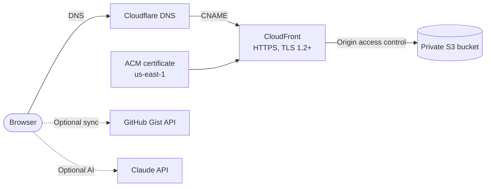
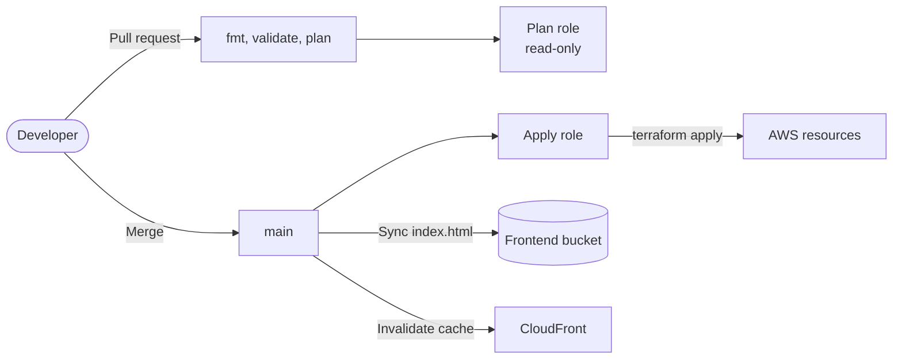

# JH TaskOps

A personal task and planning app, deployed on AWS with infrastructure as code and automated CI/CD.

> **Status:** Phase 2.1 complete.

**Live:** https://taskops.jessamyh.com

JH TaskOps builds on [JH Task Tracker](https://github.com/JessamyH/jh-task-tracker). The app itself is a single static page; this repository focuses on how it is hosted, secured and delivered on AWS.

## Features

- Task management with a weekly calendar view
- Data stored in the browser (LocalStorage), with optional sync through GitHub Gist
- AI features using your own Claude API key

## Architecture

Key decisions:

- **Private origin:** the S3 bucket is not public. CloudFront is the only entry point and reads from S3 through origin access control (OAC).
- **Custom domain:** DNS stays on Cloudflare (DNS only). The ACM certificate is issued in us-east-1 through a Terraform provider alias and renews automatically.
- **Imported, not recreated:** the existing S3 bucket, CloudFront distribution and OAC were imported into Terraform, with `terraform plan` showing no changes.
- **Remote state:** Terraform state lives in a dedicated S3 bucket with versioning, encryption, Block Public Access and native locking (`use_lockfile`).
- **Cost control:** an AWS Budget with alert thresholds.

## CI/CD

- **No stored credentials:** GitHub Actions assumes short-lived AWS roles through OIDC. No access keys exist in GitHub or in the repository history.
- **Separate roles:** a read-only Plan role runs on pull requests; the Apply role trusts only `main`.
- **On pull requests:** `terraform fmt -check`, `terraform validate` and `terraform plan`.
- **On merge to main:** `terraform apply`, sync `index.html` to S3, invalidate the CloudFront cache.
- **IAM changes** are applied locally with an admin profile before merging, because the Apply role cannot modify IAM.

See [infrastructure/README.md](infrastructure/README.md) for setup and operations.

## Project history

| Phase | Scope |
|---|---|
| 1 | Frontend on private S3 behind CloudFront over HTTPS |
| 2 | Terraform import, remote state, GitHub Actions with OIDC |
| 2.1 | Custom domain with ACM and Cloudflare |

Phase 1 verification

**Done when:** the app is served through CloudFront over HTTPS from a private S3 bucket, and existing features still work.

- Application loads successfully through CloudFront over HTTPS
- S3 bucket remains private and is accessible only through CloudFront
- LocalStorage persists application data correctly
- GitHub Gist sync continues to work
- Claude AI integration continues to work

Phase 2 verification

**Done when:** a frontend change merged to main reaches the live site automatically, infrastructure changes are reviewed through a Terraform plan on each pull request, and the repository contains no AWS credentials.

- Existing AWS resources imported into Terraform with `terraform plan` showing no changes
- Remote state with locking works locally and in GitHub Actions
- GitHub Actions assumes the Plan and Apply roles through OIDC without access keys
- Pull request plan workflow runs successfully
- Merging a frontend change to main runs `terraform apply`, syncs `index.html` to S3 and completes a CloudFront invalidation
- Live site serves the new version after the automated deploy
- Repository and git history contain no AWS credentials
- Final `terraform plan` shows no changes

Phase 2.1 verification

**Done when:** https://taskops.jessamyh.com serves the app with a valid ACM certificate, the certificate can renew automatically, and `terraform plan` shows no changes.

- https://taskops.jessamyh.com loads with a valid certificate
- HTTP redirects to HTTPS
- Validation CNAME retained for auto-renewal
- `terraform plan` shows no changes

## License

MIT. See [LICENSE](LICENSE).
