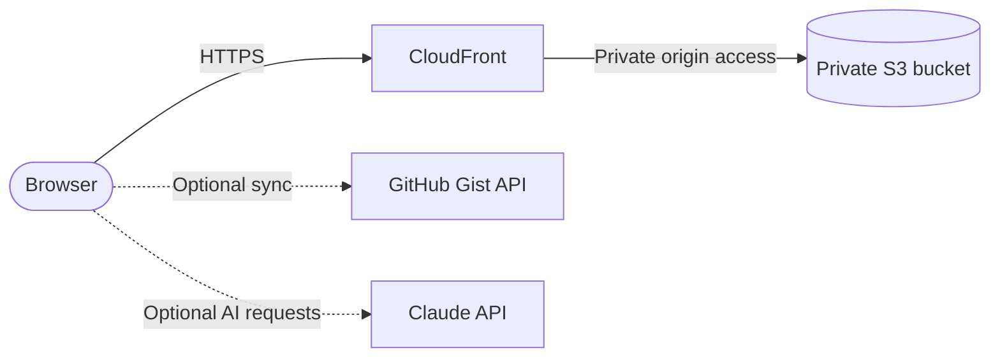
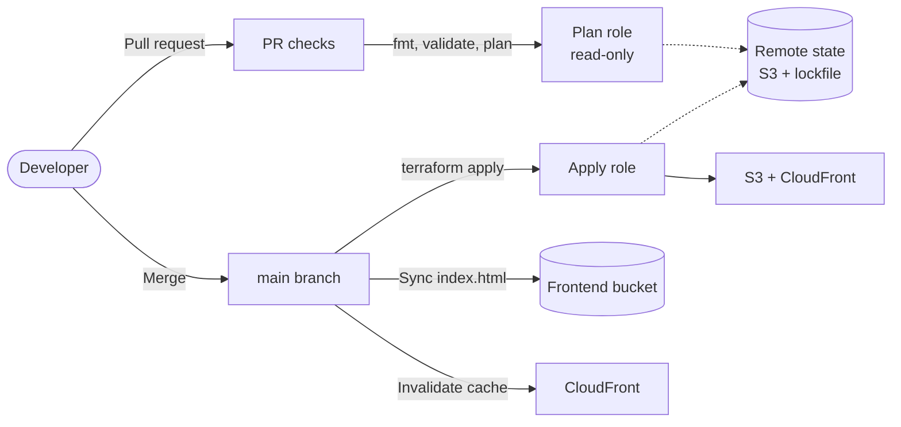

# JH TaskOps

A cloud engineering project built upon [JH Task Tracker](https://github.com/JessamyH/jh-task-tracker), exploring cloud infrastructure, DevOps automation and AI integration.

## Overview

JH TaskOps is a personal engineering project focused on evolving an existing productivity application through hands-on cloud and DevOps exploration.

This repository serves as a space for continuous learning, experimentation, and technical improvement.

## Live Demo

**[Open JH TaskOps](https://dc46h4g5wl78u.cloudfront.net)**

## Architecture

### Phase 1: AWS frontend deployment

The frontend is a single static page (`index.html`) stored in a private S3 bucket and served to users through CloudFront over HTTPS.

- **CloudFront** is the only public entry point and serves the app over HTTPS.
- **S3** is private and is not directly accessible; CloudFront reads from it as the origin.
- **Application data** stays in the browser's LocalStorage, with optional cloud sync through GitHub Gist.
- **AI features** call the Claude API directly from the browser.

**Definition of done:** JH TaskOps can be accessed through a CloudFront HTTPS URL, with the frontend stored in a private S3 bucket. Existing application functionality continues to work.

**Verified:**

- Application loads successfully through CloudFront over HTTPS
- S3 bucket remains private and is accessible through CloudFront
- LocalStorage persists application data correctly
- GitHub Gist sync continues to work
- Claude AI integration continues to work

### Phase 2: Infrastructure as Code and CI/CD

The existing AWS resources are managed with Terraform, and every merge to `main` deploys automatically through GitHub Actions. No AWS access keys are stored in GitHub or in the repository.

- **Terraform** manages the existing S3 bucket, CloudFront distribution and origin access control, which were imported without changes. See [infrastructure/README.md](infrastructure/README.md).
- **Remote state** is stored in a dedicated S3 bucket with versioning, encryption, Block Public Access and native state locking (`use_lockfile`).
- **GitHub OIDC** lets workflows assume short-lived AWS roles. The read-only Plan role runs on pull requests; the Apply role trusts only `main`.
- **Pull requests** run `terraform fmt -check`, `terraform validate` and `terraform plan`.
- **Merges to `main`** apply the Terraform plan, sync `index.html` to S3 and invalidate the CloudFront cache.
- **Cost control** uses an AWS Budget with alert thresholds.

**Definition of done:** a frontend change merged to `main` reaches the live site automatically, infrastructure changes are reviewed through a Terraform plan on each pull request, and the repository contains no AWS credentials.

**Verified:**

- Existing AWS resources imported into Terraform with `terraform plan` showing no changes
- Remote state with locking works locally and in GitHub Actions
- GitHub Actions assumes the Plan and Apply roles through OIDC without access keys
- Pull request plan workflow runs successfully
- Merging a frontend change to `main` runs Terraform apply, syncs `index.html` to S3 and completes a CloudFront invalidation
- Live site serves the new version after the automated deploy
- Repository and git history contain no AWS credentials
- Final `terraform plan` shows no changes

## License

This project is licensed under the MIT License. See the [LICENSE](LICENSE) file for details.
